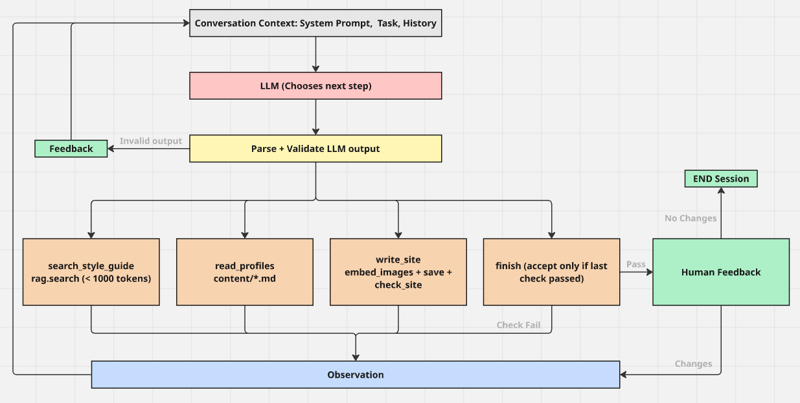

# Demo: One Agent Step

Source: [`logs/run_01.jsonl`](logs/run_01.jsonl), step 21. Text below is abbreviated; earlier history is omitted.

## 1. Input to the LLM

`llm.chat(messages)` receives role-labelled messages, not just the latest error:

```json
[
  {"role": "system", "content": "Build a team website. Return one JSON action per step. Actions: read_profiles, search_style_guide, write_site, finish."},
  {"role": "user", "content": "Build the team website from the profiles and follow the style guide."},
  {"role": "assistant", "content": "[Earlier actions and observations omitted, including the last write_site and its HTML]"},
  {"role": "user", "content": "OBSERVATION (step 20, write_site): Theme mechanism failed. 24/25 checks passed. Fix and call write_site again."}
]
```

## 2. Output from the LLM

The model chooses a targeted search (thought shortened):

```json
{
  "thought": "Look up the theme-switching requirements before correcting the page.",
  "action": "search_style_guide",
  "args": {
    "query": "theme switching mechanics CSS data-theme JavaScript implementation"
  }
}
```

## 3. What Our Code Did

Validated JSON -> embedded query -> retrieved top 5 active chunks -> appended an observation:

```json
{
  "role": "user",
  "content": "OBSERVATION (step 21, search_style_guide): [SG-20] Use data-theme=light/dark on <html>. Switch the attribute in JavaScript; use attribute selectors in CSS. [Other retrieved text omitted]"
}
```

**No website edit in this step.** Next step: the model rewrote the page and passed 25/25 checks.

## Whole Task Flow


